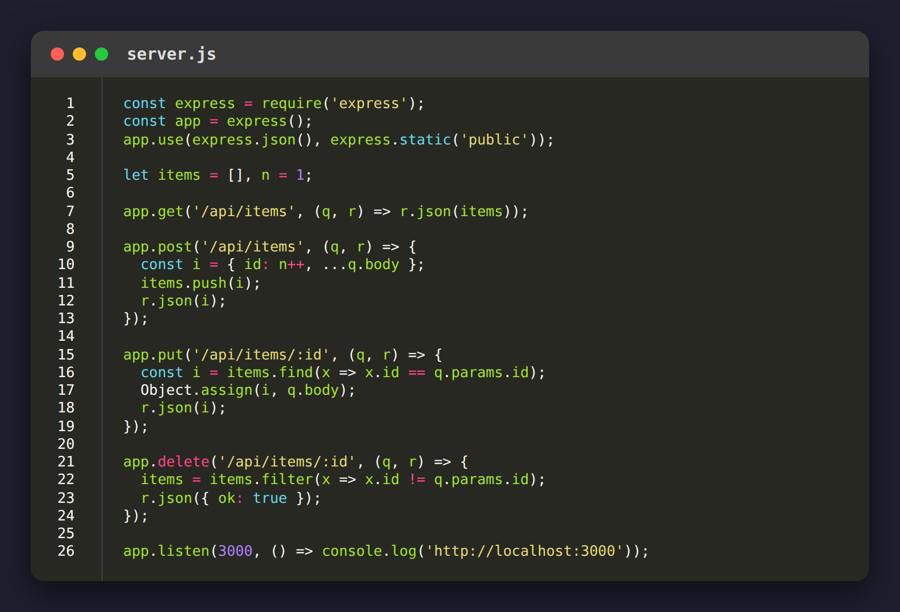
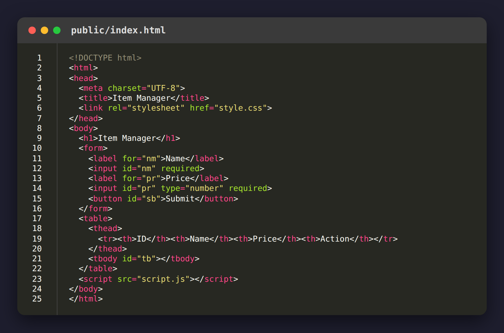
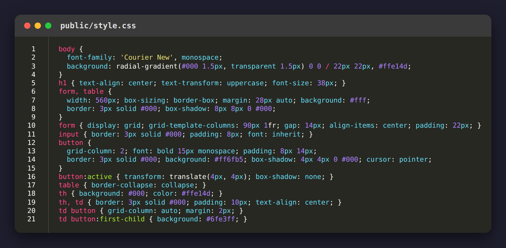
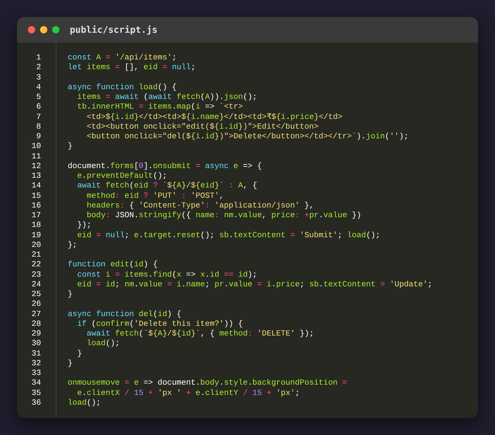

# Item Manager - MERN Lab Task 1

A front end for **CRUD operations on an array of items**, built with **HTML, CSS, Express.js and a REST API**.
Items (name and price) are kept in an in-memory array on the Express server and are created, read, updated and deleted through REST endpoints.

## Features

- Add an item with a name and price (Create)
- View all items in a table (Read)
- Edit an item: the form fills with its values and the button changes to **Update** (Update)
- Delete an item after a confirmation prompt (Delete)
- Neo-brutalist styling with a dotted background that moves with the mouse

## Tech stack

| Layer | Technology |
|---|---|
| Front end | HTML, CSS, vanilla JavaScript (`fetch`) |
| Back end | Node.js, Express.js |
| Data | In-memory JavaScript array (resets when the server restarts) |

## Project structure

```
mern-crud-lab/
├── server.js          Express server and REST API
├── package.json
├── public/
│   ├── index.html     Page: form + table
│   ├── style.css      Styling
│   └── script.js      Calls the REST API and draws the table
└── screenshots/       Images used in this README
```

## REST API

| Operation | Method | Endpoint | Description |
|---|---|---|---|
| Create | POST | `/api/items` | Add a new item (`{ "name": "Book", "price": 250 }`) |
| Read | GET | `/api/items` | Get all items |
| Update | PUT | `/api/items/:id` | Update the item with the given id |
| Delete | DELETE | `/api/items/:id` | Remove the item with the given id |

## How to run

```bash
git clone <https://github.com/Amogh-R21Dev/mern-crud-lab.git>
cd mern-crud-lab
npm install
npm start
```

Then open **http://localhost:3000** in your browser.

## Output

**1. Initial page**


**2. After adding two items**


## Code

**server.js** (Express server, items array and REST API)



**public/index.html**



**public/style.css**



**public/script.js**


