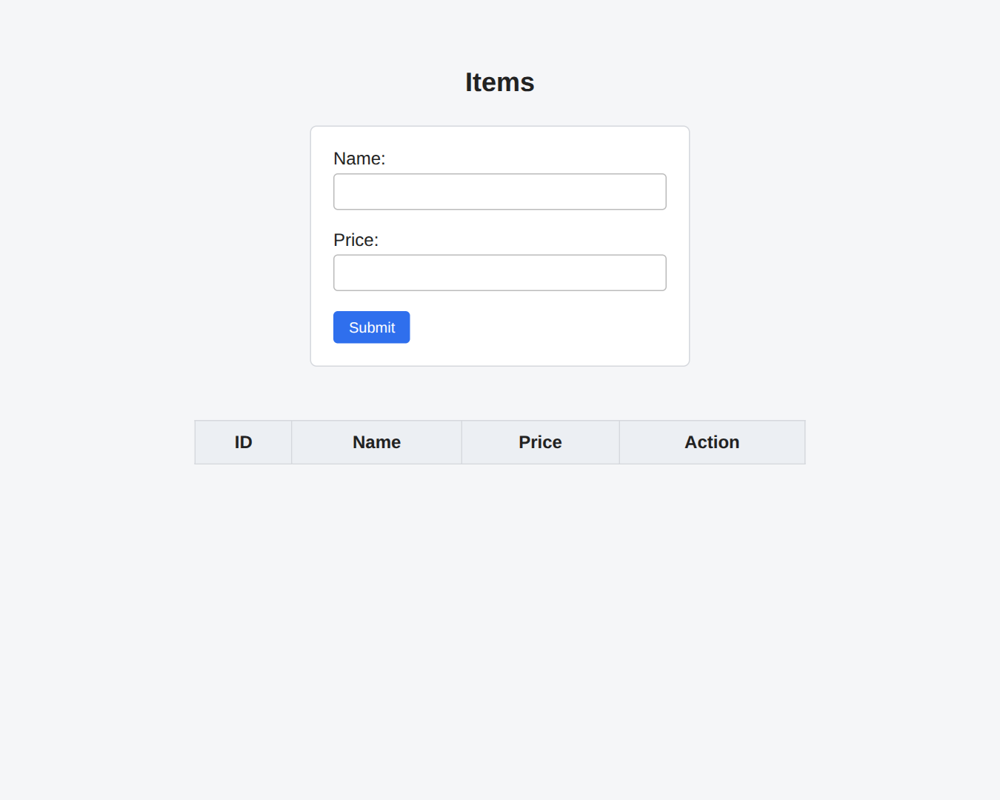
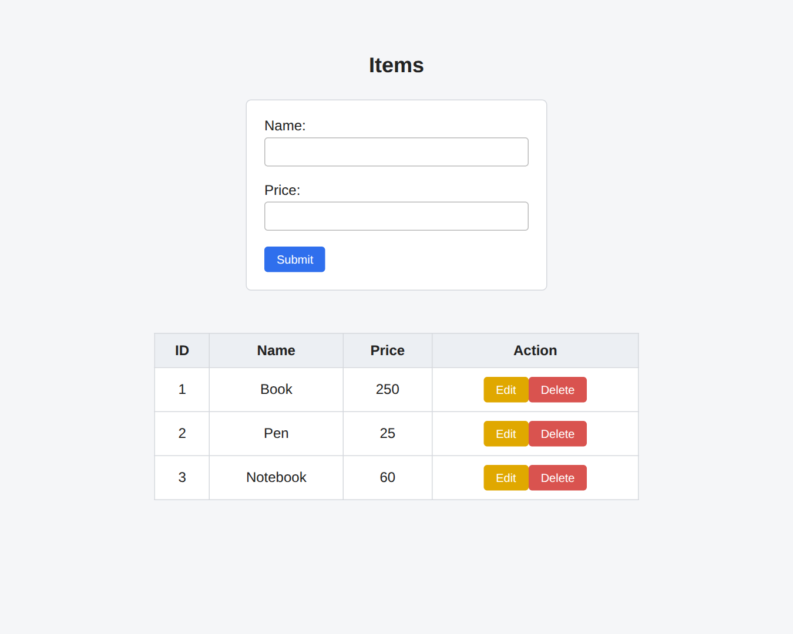
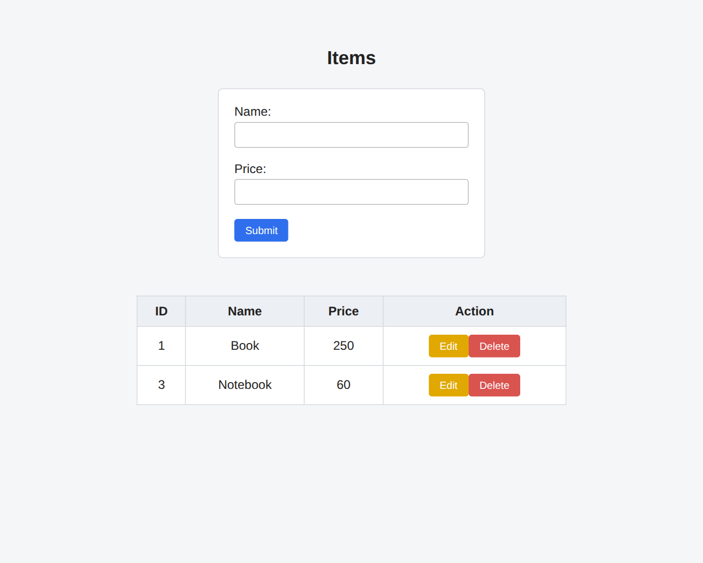

# MERN Lab Task 1 - CRUD Front End

## Output

Entry page with no items



After adding 3 items



After deleting an item



## Code

### index.html
```html
<!DOCTYPE html>
<html>
<head>
  <title>Items</title>
  <link rel="stylesheet" href="style.css">
</head>
<body>
  <h2>Items</h2>

  <form id="form">
    Name: <input type="text" id="name" required><br><br>
    Price: <input type="number" id="price" required><br><br>
    <button type="submit">Submit</button>
  </form>

  <br>

  <table>
    <thead>
      <tr><th>ID</th><th>Name</th><th>Price</th><th>Action</th></tr>
    </thead>
    <tbody id="tbody"></tbody>
  </table>

  <script src="script.js"></script>
</body>
</html>
```

### style.css
```css
body {
  font-family: Arial, sans-serif;
  background: #f5f6f8;
  margin: 0;
  padding: 40px 20px;
  color: #222;
}

h2 {
  text-align: center;
  margin-bottom: 25px;
}

form {
  background: #fff;
  border: 1px solid #d5d8dd;
  border-radius: 6px;
  padding: 20px;
  width: 300px;
  margin: 0 auto 30px;
}

input {
  width: 100%;
  padding: 8px;
  margin-top: 4px;
  border: 1px solid #bbb;
  border-radius: 4px;
  box-sizing: border-box;
}

input:focus {
  outline: none;
  border-color: #2f6fed;
}

button {
  padding: 7px 14px;
  border: none;
  border-radius: 4px;
  background: #2f6fed;
  color: #fff;
  cursor: pointer;
}

button:hover {
  background: #1f5bd0;
}

table {
  border-collapse: collapse;
  background: #fff;
  width: 550px;
  margin: 0 auto;
}

th, td {
  border: 1px solid #d5d8dd;
  padding: 10px;
  text-align: center;
}

th {
  background: #eceff3;
}

.edit { background: #e0a800; }
.edit:hover { background: #c79300; }
.del { background: #d9534f; }
.del:hover { background: #c1403c; }
```

### script.js
```js
const url = "/products"
const form = document.getElementById("form")
const nameInput = document.getElementById("name")
const priceInput = document.getElementById("price")
const tbody = document.getElementById("tbody")
let editId = null

// GET all products and show in table
async function load() {
  const res = await fetch(url)
  const items = await res.json()
  tbody.innerHTML = ""

  items.forEach((p) => {
    const { id, name, price } = p
    const row = tbody.insertRow()
    row.insertCell().textContent = id
    row.insertCell().textContent = name
    row.insertCell().textContent = price

    const action = row.insertCell()

    const editBtn = document.createElement("button")
    editBtn.textContent = "Edit"
    editBtn.className = "edit"
    editBtn.onclick = () => edit(p)

    const delBtn = document.createElement("button")
    delBtn.textContent = "Delete"
    delBtn.className = "del"
    delBtn.onclick = () => del(id)

    action.appendChild(editBtn)
    action.appendChild(delBtn)
  })
}

// POST (add) or PUT (update) on submit
form.addEventListener("submit", async (e) => {
  e.preventDefault()
  const name = nameInput.value
  const price = Number(priceInput.value)

  if (editId === null) {
    await fetch(url, {
      method: "POST",
      headers: { "Content-Type": "application/json" },
      body: JSON.stringify({ name, price })
    })
  } else {
    await fetch(url + "/" + editId, {
      method: "PUT",
      headers: { "Content-Type": "application/json" },
      body: JSON.stringify({ name, price })
    })
    editId = null
  }

  form.reset()
  load()
})

// Fill the form with the selected product
function edit(p) {
  const { id, name, price } = p
  nameInput.value = name
  priceInput.value = price
  editId = id
}

// DELETE a product by id
async function del(id) {
  await fetch(url + "/" + id, { method: "DELETE" })
  load()
}

load()
```
