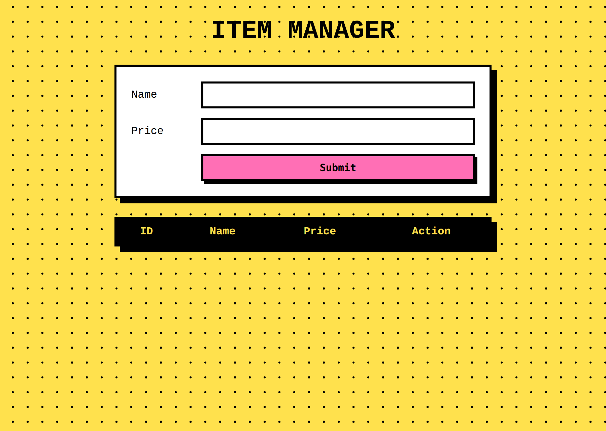
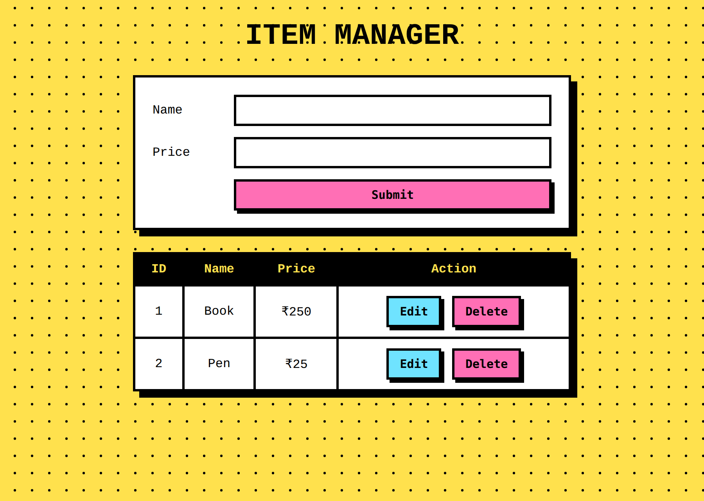

# Item Manager - MERN Lab Task 1

**Aim:** Develop a front end for CRUD operations on an array of items using **HTML, CSS, Express.js and a REST API**.

Items (name and price) are stored in an array on the Express server. The browser page lets you create, read, update and delete them by calling REST API endpoints.

## Technologies used and where to find them

| Technology | Role in this project | File |
|---|---|---|
| **HTML** | Structure of the page: the form (Name, Price, Submit) and the table (ID, Name, Price, Action) | [`public/index.html`](public/index.html) |
| **CSS** | Styling: neo-brutalist look, dotted background, buttons | [`public/style.css`](public/style.css) |
| **JavaScript (fetch)** | Calls the REST API and draws the table | [`public/script.js`](public/script.js) |
| **Express.js** | Web server, serves the page, holds the items array, defines the routes | [`server.js`](server.js) |
| **REST API** | `GET`, `POST`, `PUT`, `DELETE` on `/api/items` | [`server.js`](server.js) |


## Output

**Initial page**



**After adding two items (Book 250, Pen 25)**



## 1. HTML - `public/index.html`

Defines the form with Name and Price fields and a Submit button, and the table with the columns ID, Name, Price and Action. The rows are filled in by `script.js`.

```html
<!DOCTYPE html>
<html>
<head>
  <meta charset="UTF-8">
  <title>Item Manager</title>
  <link rel="stylesheet" href="style.css">
</head>
<body>
  <h1>Item Manager</h1>
  <form>
    <label for="nm">Name</label>
    <input id="nm" required>
    <label for="pr">Price</label>
    <input id="pr" type="number" required>
    <button id="sb">Submit</button>
  </form>
  <table>
    <thead>
      <tr><th>ID</th><th>Name</th><th>Price</th><th>Action</th></tr>
    </thead>
    <tbody id="tb"></tbody>
  </table>
  <script src="script.js"></script>
</body>
</html>
```

## 2. CSS - `public/style.css`

Styles the page with thick black borders, hard shadows and a dotted background. The Edit and Delete buttons have their own colours.

```css
body {
  font-family: 'Courier New', monospace;
  background: radial-gradient(#000 1.5px, transparent 1.5px) 0 0 / 22px 22px, #ffe14d;
}
h1 { text-align: center; text-transform: uppercase; font-size: 38px; }
form, table {
  width: 560px; box-sizing: border-box; margin: 28px auto; background: #fff;
  border: 3px solid #000; box-shadow: 8px 8px 0 #000;
}
form { display: grid; grid-template-columns: 90px 1fr; gap: 14px; align-items: center; padding: 22px; }
input { border: 3px solid #000; padding: 8px; font: inherit; }
button {
  grid-column: 2; font: bold 15px monospace; padding: 8px 14px;
  border: 3px solid #000; background: #ff6fb5; box-shadow: 4px 4px 0 #000; cursor: pointer;
}
button:active { transform: translate(4px, 4px); box-shadow: none; }
table { border-collapse: collapse; }
th { background: #000; color: #ffe14d; }
th, td { border: 3px solid #000; padding: 10px; text-align: center; }
td button { grid-column: auto; margin: 2px; }
td button:first-child { background: #6fe3ff; }
```

## 3. Express.js - `server.js`

- Creates the Express app and turns on `express.json()` (reads JSON request bodies) and `express.static('public')` (serves the HTML, CSS and JS files).
- Keeps the data in an array: `let items = []`.
- Defines the REST routes and starts the server on port 3000.

```js
const express = require('express');
const app = express();
app.use(express.json(), express.static('public'));

let items = [], n = 1;

app.get('/api/items', (q, r) => r.json(items));

app.post('/api/items', (q, r) => {
  const i = { id: n++, ...q.body };
  items.push(i);
  r.json(i);
});

app.put('/api/items/:id', (q, r) => {
  const i = items.find(x => x.id == q.params.id);
  Object.assign(i, q.body);
  r.json(i);
});

app.delete('/api/items/:id', (q, r) => {
  items = items.filter(x => x.id != q.params.id);
  r.json({ ok: true });
});

app.listen(3000, () => console.log('http://localhost:3000'));
```

## 4. REST API - `/api/items`

| Operation | HTTP method | Endpoint | What the server does |
|---|---|---|---|
| Create | POST | `/api/items` | Adds a new item to the array |
| Read | GET | `/api/items` | Returns all items as JSON |
| Update | PUT | `/api/items/:id` | Changes the item with that id |
| Delete | DELETE | `/api/items/:id` | Removes the item with that id |

**Testing the API from the terminal** (Linux/macOS syntax; on Windows PowerShell use `curl.exe`, or use Postman):

```bash
curl -s -X POST localhost:3000/api/items -H 'Content-Type: application/json' -d '{"name":"Book","price":250}'
curl -s -X POST localhost:3000/api/items -H 'Content-Type: application/json' -d '{"name":"Pen","price":25}'
curl -s localhost:3000/api/items
curl -s -X PUT localhost:3000/api/items/2 -H 'Content-Type: application/json' -d '{"name":"Pen","price":30}'
curl -s -X DELETE localhost:3000/api/items/1
curl -s localhost:3000/api/items
```

Result of these calls:


`GET /api/items` opened in the browser:


## 5. Connecting front end and API - `public/script.js`

`load()` calls `GET /api/items` and builds the table rows. The form's submit handler sends `POST` (new item) or `PUT` (when editing). `del()` sends `DELETE`.

```js
const A = '/api/items';
let items = [], eid = null;

async function load() {
  items = await (await fetch(A)).json();
  tb.innerHTML = items.map(i => `<tr>
    <td>${i.id}</td><td>${i.name}</td><td>₹${i.price}</td>
    <td><button onclick="edit(${i.id})">Edit</button>
    <button onclick="del(${i.id})">Delete</button></td></tr>`).join('');
}

document.forms[0].onsubmit = async e => {
  e.preventDefault();
  await fetch(eid ? `${A}/${eid}` : A, {
    method: eid ? 'PUT' : 'POST',
    headers: { 'Content-Type': 'application/json' },
    body: JSON.stringify({ name: nm.value, price: +pr.value })
  });
  eid = null; e.target.reset(); sb.textContent = 'Submit'; load();
};

function edit(id) {
  const i = items.find(x => x.id == id);
  eid = id; nm.value = i.name; pr.value = i.price; sb.textContent = 'Update';
}

async function del(id) {
  if (confirm('Delete this item?')) {
    await fetch(`${A}/${id}`, { method: 'DELETE' });
    load();
  }
}

onmousemove = e => document.body.style.backgroundPosition =
  e.clientX / 15 + 'px ' + e.clientY / 15 + 'px';
load();
```

## How to run

```bash
git clone https://github.com/Amogh-R21Dev/mern-crud-lab.git
cd mern-crud-lab
npm install
npm start
```

Open **http://localhost:3000** in your browser.

## Project structure

```
mern-crud-lab/
├── server.js          Express server + REST API
├── package.json
├── public/
│   ├── index.html     HTML
│   ├── style.css      CSS
│   └── script.js      Front-end logic (fetch)
└── screenshots/       Output images used in this README
```
